# Relatório de Análise Arquitetural: StreamFlow

**Disciplina:** Serviços Web, IFSul Campus Passo Fundo  
**Professor:** Élder F. F. Bernardi  
**Autora:** Marjory Ane Toazza  
**Data:** 04/11/2026  
**Commit analisado:** `ea0c63bc097304d87e7fcb8fa690d7d13d6c8ffa`  
**Ambiente:** Windows 11 com Git Bash, Docker 29.9.2, Docker Compose v5.6.1

```bash
git rev-parse HEAD
docker --version
docker compose version
docker compose ps
```

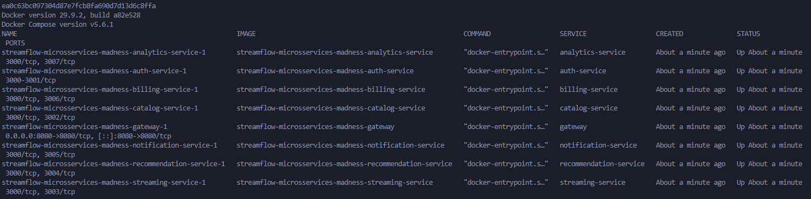

---

## Contexto

Este relatório responde ao e-mail do VP de Produto, Marcos Oliveira. As fontes foram o código dos 8 componentes (gateway e 7 serviços), a especificação `arquitetura_streamflow_reference.md`, o guia da disciplina (`docs/guia_completo_microsservicos.md`), o vídeo [Microservices at Scale](https://www.youtube.com/watch?v=ILXcsNxbas4) e os quatro cenários de `docs/DEBUG.md`, executados localmente com Docker Compose.

**Como os testes foram feitos.** O token foi obtido com o login do `docs/SETUP.md`:

```bash
TOKEN=$(curl -s -X POST http://localhost:8080/auth/login \
  -H "Content-Type: application/json" \
  -d '{"email":"admin@streamflow.com","password":"admin123"}' | jq -r '.token')
```

Para medir o tempo, cada `curl` usou a opção indicada no `docs/DEBUG.md`, `-w "\nhttp=%{http_code} tempo=%{time_total}s\n"`, que mostra o código HTTP e o tempo total da resposta. Cada medição repetiu o mesmo comando 6 vezes: a primeira serviu de aquecimento e as outras 5 deram a mediana, o mínimo e o máximo. Os testes rodaram num notebook e não representam carga de produção. Todo serviço parado num cenário foi religado com `docker compose start` antes do cenário seguinte.

Todos os testes rodaram em 04/11/2026, com os bancos recriados do zero (`docker compose down -v` e `docker compose up --build -d`). O Cenário 1 foi medido de novo no final, depois dos outros cenários, e por isso os Plays dele aparecem com as sessões 24 a 29. Cada número citado no texto corresponde ao print ao lado.

Custos, incidentes e a saída dos tech leads fazem parte do cenário fictício e estão marcados como *(premissa)*. O que não foi testado está marcado como *(hipótese)*.

---

## Resumo executivo

Marcos, a StreamFlow não precisa ser desmontada. Encontramos quatro problemas que explicam boa parte das queixas, e todos podem ser corrigidos sem reescrever o sistema.

O Play espera tarefas que podiam ficar para depois. Ele aguarda o registro no histórico e o envio de uma notificação antes de responder. Medimos 265 ms no Play contra 5 ms na listagem do catálogo, e cerca de 210 ms dessa diferença vêm de uma espera proposital da notificação. Com a notificação desligada, o Play passou a levar 2,4 segundos. Propomos deixar no caminho só a checagem de licença e mandar o resto para uma fila.

O painel de saúde marca o sistema como degradado o tempo todo. Um erro de código faz o health check responder "degradado" mesmo com tudo funcionando, então ele não serve como alarme. A correção é de uma linha.

Não dá para seguir uma requisição entre os serviços. Cada serviço numera os próprios registros e não repassa o número adiante. Por isso os incidentes ficam sem diagnóstico. A primeira ação é um identificador único por requisição, registrado em todos os serviços.

Faturamento e relatórios usam o mesmo banco. Desligamos o faturamento e o relatório continuou funcionando, porque os dois leem o mesmo arquivo. Propomos juntar os dois em um serviço financeiro.

O repositório não tem fatura, pipeline de deploy nem monitoramento, então o aumento de 40% não pode ser confirmado com o que temos. O Prime Video consolidou um único serviço que trocava grande volume de dados entre componentes cobrados por uso. Nosso cenário é outro, e uma economia de 90% não deve ser esperada.

Devem continuar como estão o gateway com login centralizado e os serviços de identidade, catálogo, reprodução e recomendação. Na equipe, cada rotina operacional precisa de duas pessoas treinadas e de um procedimento escrito.

---

## Seção 1: Custo Operacional Oculto

> _"Temos mais gente mantendo infraestrutura do que escrevendo features."_

**Marcos está parcialmente certo.** Dois serviços dão trabalho de manutenção sem trazer retorno. Já o pipeline e o monitoramento que ele cita para cada serviço não existem no repositório. O aumento de 40% é premissa do cenário, sem fatura para conferir.

### Diagnóstico

| Item | Quantidade |
|---|---|
| Componentes | 8 (gateway e 7 serviços) |
| Dockerfiles | 8, todos com a imagem `node:22-bookworm-slim` |
| Containers em execução | 8 |
| Bancos SQLite | 5 arquivos (billing e analytics usam o mesmo `shared_billing.db`) |
| Volumes e redes | 5 volumes e 1 rede |
| Portas abertas no computador | 1 (8080, do gateway) |
| Pipelines de deploy automático (CI/CD) | **não existem** |
| Métricas, alertas e tracing | **não existem** (só o `/health` do gateway) |
| Service mesh | **não existe** no repositório *(premissa do e-mail)* |
| Memória com o sistema parado | 164,4 MiB somando os 8 containers |

> **Evidência (04/11/2026):** inventário com todos os serviços ativos. A memória vale para o notebook do teste e não serve para estimar a fatura.
>
> ```bash
> find . -name Dockerfile
> ls -a                                   # não há pasta .github nem outro arquivo de pipeline
> docker volume ls
> docker network ls
> docker compose exec auth-service ls /app/data      # repetido para cada serviço
> docker stats --no-stream
> ```
>
> 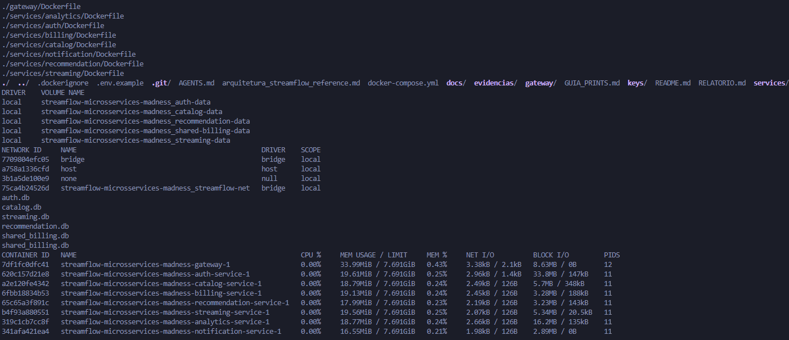

**Notification.** Não tem banco nem regra de negócio. A rota `/notify` só espera um tempo sorteado entre 100 e 300 ms e responde ([services/notification/index.js](services/notification/index.js)). Mesmo assim ocupa um container de 16,6 MiB e fica no caminho do Play.

**Billing e Analytics.** Os dois usam o mesmo arquivo `shared_billing.db` ([docker-compose.yml](docker-compose.yml)). Custam como dois serviços, mas uma mudança em um pode quebrar o outro.

**Diferenças entre documentação e código:**
- Os Dockerfiles declaram a porta 3000, mas os serviços usam as portas 3001 a 3007. O print P01 mostra as duas portas em cada container.
- A especificação diz que o gateway grava logs em JSON. O código grava em texto colorido ([gateway/index.js](gateway/index.js)), como mostra o print P06b.

**Base no guia:** seção 2.5 (Quando não adotar microsserviços) e seção 15 (Erros Comuns e Antipadrões).

**Vídeo (1:50 a 3:00 e 4:04 a 4:34):** o vídeo fala da "economia oculta", a infraestrutura passa a exigir uma equipe só para ela, que não trabalha no produto. A StreamFlow não usa Kubernetes, mas o efeito aparece em escala menor: 8 Dockerfiles e 8 containers para manter, dois deles sem retorno.

### Proposta

1. **Tirar o Notification do caminho do Play.** Ele passa a ler os pedidos de uma fila, sem o Play esperar por ele.
2. **Juntar Billing e Analytics** em um serviço financeiro com banco próprio.
3. **Manter Auth, Catalog, Streaming, Recommendation e o gateway**, que têm dados e funções próprios.
4. **Medir antes de cortar.** Com métricas por serviço dá para saber de onde vem o aumento de custo.

---

## Seção 2: Latência de Rede

> _"Um clique no Play toca 12 serviços antes do vídeo iniciar."_

**Marcos exagera no número, mas o problema existe.** O Play passa pelo gateway e por 4 serviços, não por 12. Dois deles são chamados em sequência sem necessidade, e quando um cai o Play fica quase dez vezes mais lento.

### Diagnóstico: as chamadas em sequência

Fluxo do `POST /streaming/play` ([services/streaming/index.js](services/streaming/index.js)):

```
Cliente
  → Gateway (confere o token sozinho, sem chamar o auth)
    → Streaming
        ├─ [1] GET  catalog/:id/license        espera a resposta, limite de 5 s
        ├─ [2] POST recommendation/viewed      espera a resposta, limite de 5 s
        ├─ [3] POST notification/notify        espera a resposta, limite de 5 s (espera 100 a 300 ms)
        └─ [4] grava a sessão no banco do streaming
  ← 201 Created
```

São **5 chamadas HTTP**: cliente para gateway, gateway para streaming e 3 chamadas internas, uma depois da outra. Auth, billing e analytics não participam. Como o Play não consulta o billing, um usuário com assinatura cancelada consegue assistir.

> **Evidência, Cenário 1 (04/11/2026):** todos os serviços ativos. Cada `curl` foi repetido 6 vezes.
>
> ```bash
> docker compose up -d --force-recreate notification-service   # recria o container para o log começar vazio
> curl -s -w "\nhttp=%{http_code} tempo=%{time_total}s\n" -X POST http://localhost:8080/api/streaming/play \
>   -H "Content-Type: application/json" -H "Authorization: Bearer $TOKEN" -d '{"movieId": 2}'
> curl -s -w "\nhttp=%{http_code} tempo=%{time_total}s\n" http://localhost:8080/api/catalog \
>   -H "Authorization: Bearer $TOKEN"
> docker compose logs notification-service
> docker compose logs notification-service | grep -o '"delay":[0-9]*'
> ```
>
> | Rota | HTTP | Mediana | Mínimo a máximo |
> |---|---|---|---|
> | `POST /api/streaming/play` | 201 | 265 ms | 181 a 350 ms |
> | `GET /api/catalog` | 200 | 4,9 ms | 4,7 a 5,2 ms |
>
> 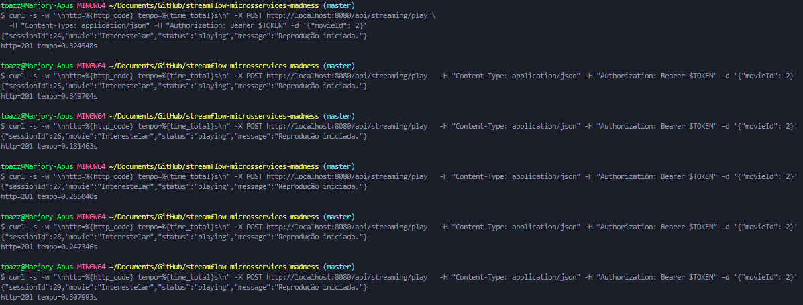
>
> 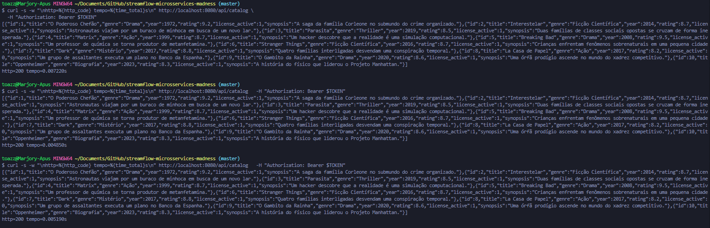
>
> 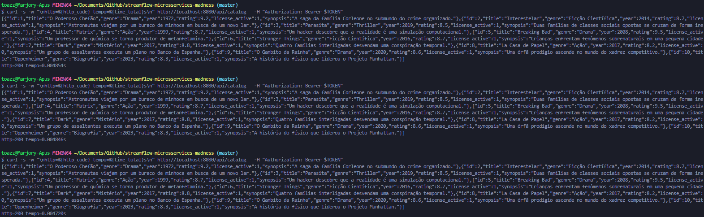
>
> 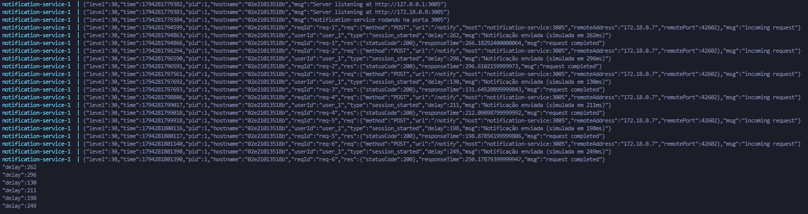

A diferença entre as medianas é de cerca de 260 ms, e a rede explica pouco dela. O log do notification mostra quanto ele esperou em cada Play: 262 ms no aquecimento e 296, 130, 211, 198 e 249 ms nas medições. Tirando essa espera do tempo de cada Play, sobram de 49 a 59 ms, com mediana de 54 ms. A espera proposital (mediana de 211 ms) responde por cerca de 80% da diferença.

O log do Play da sessão 10 (prints P06a e P06b) mostra o tempo gasto em cada serviço:

| Etapa | Tempo |
|---|---|
| catalog (licença) | 0,4 ms |
| recommendation (gravar histórico) | 22,3 ms |
| notification (espera sorteada de 176 ms) | 177,2 ms |
| total no streaming | 217,5 ms |

### Diagnóstico: o que acontece quando um serviço cai

> **Evidência, Cenário 2 (04/11/2026):** notification parado. O `curl` foi repetido 6 vezes. Restauração com `docker compose start notification-service`.
>
> ```bash
> docker compose stop notification-service
> curl -s -w "\nhttp=%{http_code} tempo=%{time_total}s\n" -X POST http://localhost:8080/api/streaming/play \
>   -H "Content-Type: application/json" -H "Authorization: Bearer $TOKEN" -d '{"movieId": 2}'
> ```
>
> | Condição | HTTP | Mediana | Mínimo a máximo |
> |---|---|---|---|
> | Notification ativo (Cenário 1) | 201 | 265 ms | 181 a 350 ms |
> | Notification parado | 201 | 2.439 ms | 2.341 a 2.459 ms |
>
> 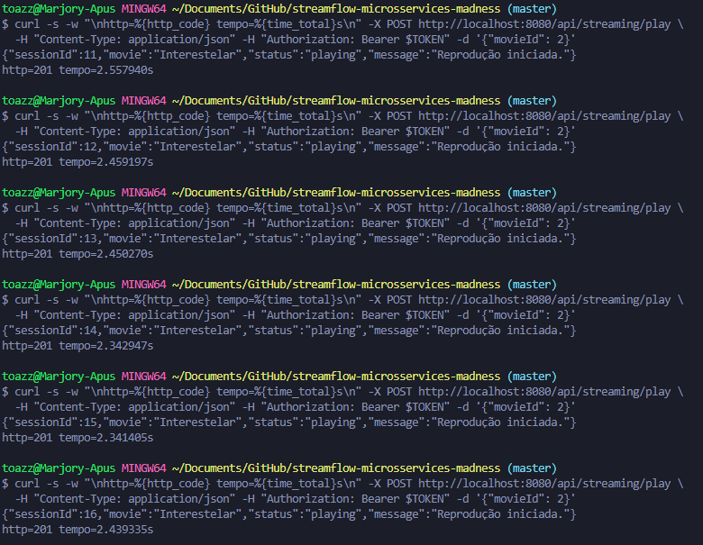
>
> Warnings no log do streaming (comando do `docs/DEBUG.md`):
>
> ```bash
> docker compose logs streaming-service | grep '"level":40'
> ```
>
> 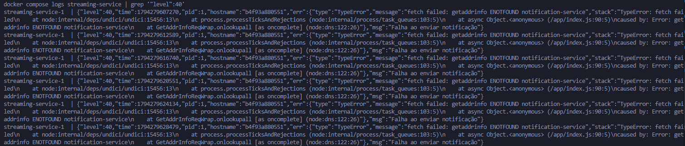

O Play continuou respondendo 201 sem avisar o cliente de que a notificação falhou. O código só grava um warning no log.

O tempo saltou para 2,4 s. O erro no log é `ENOTFOUND`, que quer dizer "nome não encontrado". Quando o container para, o Docker tira o nome `notification-service` da rede. A cada Play o streaming tenta achar esse nome e só desiste depois de cerca de 2,4 s. Em outra máquina esse tempo pode ser diferente *(hipótese)*.

O `docs/DEBUG.md` diz que parar o container "pode provocar recusa imediata de conexão". No teste a falha não foi imediata: cada Play esperou cerca de 2,4 s.

Como o código reage a cada tipo de falha:

| Falha | Efeito no Play |
|---|---|
| Serviço parado (**medido**) | continua, mas cerca de 2,2 s mais lento para cada serviço parado |
| Serviço responde com erro, como 500 | continua sem registrar nada, porque o código não confere se a resposta deu certo |
| Serviço trava sem responder *(hipótese)* | espera até 5 s por chamada, 15 s se as três travarem |

**Base no guia:** seção 5.1 (Comunicação Síncrona), seção 3.5 (Tolerância a Falhas) e seção 14.3 (Timeout).

**Vídeo (4:38 a 5:19):** o vídeo diz que um clique no Play "*might touch a dozen services*" (pode passar por uma dúzia de serviços). É provavelmente a origem dos "12 serviços" do Marcos, mas o vídeo fala de uma possibilidade, e na StreamFlow o Play passa por 5 componentes. Logo depois, o vídeo diz que cada chamada passa pela rede e que "*every hop adds latency and latency compounds*" (cada salto soma latência). Nas medições, a rede custou poucos milissegundos, e a maior parte do tempo do Play foi a espera proposital do notification. O custo grande apareceu quando um serviço caiu: cada serviço parado deixou o Play cerca de 2,2 s mais lento.

### Proposta

| Chamada | Hoje | Proposta | Motivo |
|---|---|---|---|
| catalog (licença) | espera a resposta | **manter**, com limite de 500 ms | sem licença não pode haver reprodução |
| recommendation (histórico) | espera a resposta | **fila** | o histórico pode ser gravado segundos depois |
| notification | espera a resposta | **fila** | a notificação não decide se o Play acontece |
| billing (assinatura) | não existe | **avaliar** consulta com cache | regra de negócio que hoje falta |

Antes da fila, baixar o limite de espera de recommendation e notification para 300 ms já reduz o atraso medido no Cenário 2.

Riscos da fila e como tratar:
- **Perder o aviso** se o streaming cair logo depois de gravar a sessão. Solução: gravar a sessão e o aviso pendente juntos no banco do streaming, e enviar o aviso para a fila depois.
- **Receber o mesmo aviso duas vezes.** Solução: o serviço que recebe usa o número da sessão para ignorar repetidos.
- **Mais um sistema para operar** (a própria fila, como RabbitMQ), numa equipe que perdeu gente.

**Como validar:** repetir os Cenários 1 e 2. O Play deve ficar perto do tempo do catálogo nos dois casos.

---

## Seção 3: Observabilidade Frágil

> _"Tivemos 3 incidentes e não sabemos nem onde foi."_

**Marcos está certo.** Com os logs atuais não dá para saber onde foi o problema, quanto durou e quantos usuários afetou. O health check também está quebrado. Os 3 incidentes são premissa do cenário, mas a falta de ferramentas para investigá-los foi comprovada.

### Diagnóstico

O que existe: logs em cada serviço e um `/health` no gateway que consulta todos os serviços ([gateway/index.js](gateway/index.js)). O streaming registra o filme e o usuário no início do Play, mas os warnings de falha não trazem esses dados (print P05).

| Pergunta do incidente | O que seria preciso | Situação |
|---|---|---|
| Onde foi? | tracing (caminho da requisição em todos os serviços) | não existe |
| Quanto durou? | métricas guardadas ao longo do tempo | não existem |
| Quantos usuários? | logs reunidos num lugar só, com o usuário | cada serviço loga separado, e o usuário falta nos erros |
| Quem avisa a equipe? | alertas | não existem |

> **Evidência (04/11/2026):** um Play enviado com um identificador próprio no cabeçalho `x-request-id`, e depois a leitura dos logs dos cinco componentes.
>
> ```bash
> curl -s -X POST http://localhost:8080/api/streaming/play -H "x-request-id: rastreio-1793844447" \
>   -H "Content-Type: application/json" -H "Authorization: Bearer $TOKEN" -d '{"movieId": 2}'
> docker compose logs --since 30s gateway streaming-service catalog-service recommendation-service notification-service
> docker compose logs | grep -c rastreio-1793844447
> ```
>
> | Componente | ID registrado para o mesmo Play |
> |---|---|
> | gateway | `req-h` |
> | streaming | `req-a` |
> | catalog | `req-g` |
> | recommendation | `req-a` |
> | notification | `req-a` |
> | Linhas com o identificador enviado | 0 |
>
> 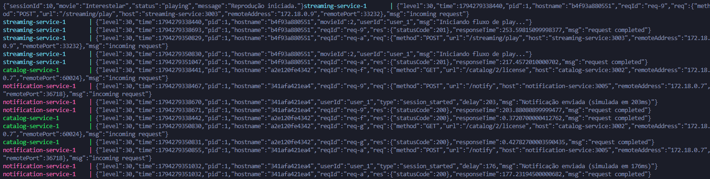
>
> 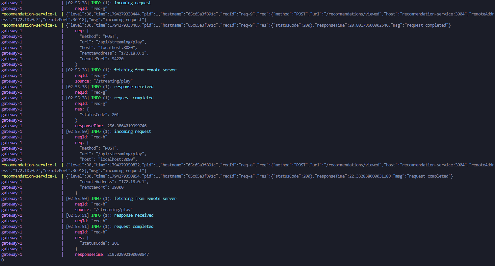

A janela de 30 segundos pegou dois Plays. O do teste é o segundo, que criou a sessão 10 (primeira linha do print).

Cada serviço cria o próprio número de requisição e não o repassa adiante. O identificador enviado pelo cliente foi descartado. Streaming, recommendation e notification mostram o mesmo `req-a` por coincidência: cada um conta as próprias requisições desde que ligou, e os três receberam uma requisição por Play. O gateway (`req-h`) e o catalog (`req-g`) receberam outras chamadas antes, e os números já não batem. Para juntar as linhas de um mesmo Play, a equipe teria que comparar horários em cinco logs.

**O health check responde "degraded" mesmo com tudo funcionando.**

> **Evidência, Cenário 4 (04/11/2026):** health com tudo ativo, depois com o recommendation parado. Restauração com `docker compose start recommendation-service`.
>
> ```bash
> curl -s http://localhost:8080/api/recommendations/user_1 -H "Authorization: Bearer $TOKEN"   # histórico antes
> curl -s -w "\nhttp=%{http_code} tempo=%{time_total}s\n" http://localhost:8080/health
> docker compose stop recommendation-service
> curl -s -w "\nhttp=%{http_code} tempo=%{time_total}s\n" http://localhost:8080/health
> curl -s -w "\nhttp=%{http_code} tempo=%{time_total}s\n" -X POST http://localhost:8080/api/streaming/play \
>   -H "Content-Type: application/json" -H "Authorization: Bearer $TOKEN" -d '{"movieId": 2}'
> ```
>
> 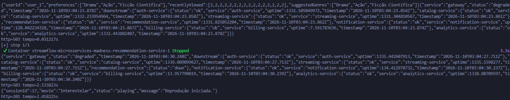
>
> Depois de religar o recommendation, o histórico foi consultado de novo e foram feitos dois Plays que o negócio recusa (filme sem licença e filme inexistente):
>
> ```bash
> docker compose start recommendation-service
> curl -s http://localhost:8080/api/recommendations/user_1 -H "Authorization: Bearer $TOKEN"   # histórico depois
> curl -s -w "\nhttp=%{http_code} tempo=%{time_total}s\n" http://localhost:8080/health
> curl -s -w "\nhttp=%{http_code} tempo=%{time_total}s\n" -X POST http://localhost:8080/api/streaming/play \
>   -H "Content-Type: application/json" -H "Authorization: Bearer $TOKEN" -d '{"movieId": 8}'
> curl -s -w "\nhttp=%{http_code} tempo=%{time_total}s\n" -X POST http://localhost:8080/api/streaming/play \
>   -H "Content-Type: application/json" -H "Authorization: Bearer $TOKEN" -d '{"movieId": 999}'
> ```
>
> 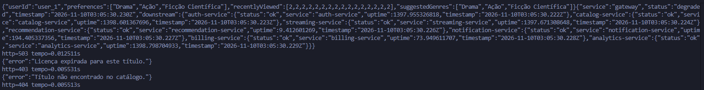
>
> | Situação | `/health` | Play |
> |---|---|---|
> | Todos ativos | 503, `degraded` (os 7 serviços com `"status":"ok"`), em 31 ms | |
> | Recommendation parado | 503, `degraded`, em 2,5 s | 201 em 2,5 s, sem gravar no histórico |
> | Recommendation religado | 503, `degraded`, em 13 ms | |
> | Filme 8 (licença inativa) | | 403, "Licença expirada para este título." |
> | Filme 999 (não existe) | | 404, "Título não encontrado no catálogo." |

O erro está no gateway ([gateway/index.js](gateway/index.js)):

```javascript
results[name] = { status: 'up', ...data };
const allUp = Object.values(results).every(r => r.status === 'up');
```

Cada serviço responde `status: 'ok'`. Na primeira linha, o `'ok'` que vem em `data` substitui o `'up'` escrito antes. A segunda linha procura `'up'`, não encontra e declara o sistema degradado. Por isso o health nunca devolve 200, e o `docs/DEBUG.md` erra ao dizer que o status "muda para degraded" quando um serviço para: ele já começa assim.

Na prática, o health deu a mesma resposta com tudo ativo, com um serviço parado e depois de religá-lo. Um alarme ligado a ele tocaria sempre, e a equipe passaria a ignorá-lo *(hipótese)*.

Mesmo corrigido, ele continuaria limitado:
- Cada serviço responde `'ok'` sem testar o próprio banco. Isso só mostra que o processo está ligado.
- O gateway consulta os 7 serviços um de cada vez, e com o recommendation parado a resposta demorou 2,5 s.
- Notification parado gera o mesmo alerta que catalog parado, mas só o catalog impede o Play.
- Com o recommendation parado, o Play deu 201, mas o histórico ficou com as mesmas 16 visualizações de antes. A perda só aparece num warning do log.

**Base no guia:** seção 13.1 (Os Três Pilares da Observabilidade), seção 13.2 (Correlation ID) e seção 13.3 (Health Checks).

**Vídeo (3:04 a 3:22 e 5:54 a 6:19):** o vídeo diz que tracing e logs reunidos num lugar só viram obrigatórios em microsserviços, e cada um é mais uma ferramenta para operar. A StreamFlow não tem nenhum dos dois. Como a equipe perdeu quem conhecia tracing, o melhor começo é o que não exige ferramenta nova: corrigir o health e passar o mesmo ID entre os serviços.

### Proposta

1. **Corrigir o health** (minutos): inverter a ordem para `results[name] = { ...data, status: 'up' }`.
2. **Correlation ID** (poucos dias): o gateway cria um `x-request-id` e todos os serviços o repassam e registram. Os warnings passam a incluir o usuário e o filme.
3. **Logs num lugar só**, com busca pelo `x-request-id` e pelo usuário.
4. **Métricas e alertas** (por exemplo Prometheus e Grafana): tempo e taxa de erro do Play, com alerta quando o erro passar de 1% por 5 minutos.
5. **Tracing** (por exemplo OpenTelemetry com Jaeger), mostrando o tempo de cada chamada do Play.
6. **Health mais útil:** cada serviço testa o próprio banco, o gateway consulta todos ao mesmo tempo, e um Play de teste roda a cada minuto.

**Como validar:** repetir os testes dos prints P06 e P07. O mesmo ID deve aparecer nos cinco serviços, e o health deve dar 200 com tudo ativo.

---

## Seção 4: Consistência Eventual

> _"Recomendações mostrando conteúdo que já foi removido."_

**Marcos está certo.** Nada no código avisa o serviço de recomendação quando o catálogo muda. Consistência eventual (os dados ficam diferentes por um tempo e depois voltam a concordar) seria aceitável aqui, mas falta o mecanismo que faz os dados voltarem a concordar.

### Diagnóstico

| Dado | Dono | Cópia em | Como sincroniza hoje |
|---|---|---|---|
| Filme e licença | catalog | recommendation (histórico) e streaming (sessões) | não sincroniza |
| Visualização | recommendation | | só é gravada se a chamada do Play funcionar |
| Assinatura | billing | | o Play não consulta |
| Sessão | streaming | | toda sessão fica `active` para sempre, porque não há rota para encerrar |

O histórico guarda só o número do filme, e a lista `recentlyViewed` é montada sem consultar o catálogo ([services/recommendation/index.js](services/recommendation/index.js)). O catálogo não tem rota para remover filmes, então a remoção foi simulada desativando a licença.

> **Evidência (04/11/2026):** licença do filme 2 (Interestelar) desativada direto no banco do catalog, do jeito que o `docs/DEBUG.md` ensina, e reativada no final.
>
> ```bash
> docker compose exec catalog-service sh
> apt-get update && apt-get install -y sqlite3
> sqlite3 /app/data/catalog.db
> UPDATE movies SET license_active=0 WHERE id=2;
> SELECT id, title, license_active FROM movies WHERE id=2;
> .quit
> exit
>
> curl -s http://localhost:8080/api/catalog/2/license -H "Authorization: Bearer $TOKEN"
> curl -s http://localhost:8080/api/recommendations/user_1 -H "Authorization: Bearer $TOKEN"
> curl -s -w "\nhttp=%{http_code} tempo=%{time_total}s\n" -X POST http://localhost:8080/api/streaming/play \
>   -H "Content-Type: application/json" -H "Authorization: Bearer $TOKEN" -d '{"movieId": 2}'
> # restauração: o mesmo UPDATE com license_active=1
> ```
>
> | Consulta | Resultado |
> |---|---|
> | Licença no catálogo | `"licensed": false` |
> | Histórico de recomendações | continua mostrando o filme 2 |
> | Play do filme 2 | 403, "Licença expirada para este título." |
>
> 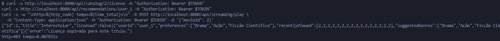

O usuário vê Interestelar em "assistidos recentemente", clica e recebe "licença expirada". É a queixa do Marcos reproduzida no laboratório. O Cenário 4 mostrou o caso oposto: com o recommendation parado, a visualização se perdeu e nada a recupera.

### Consistência necessária em cada caso

| Caso | Regra de negócio | Consistência | Atraso aceitável |
|---|---|---|---|
| Licença no Play | nunca reproduzir sem licença | imediata | zero |
| Assinatura no Play | não reproduzir sem assinatura ativa | quase imediata, com cache | até 5 min |
| Histórico | toda reprodução entra uma vez | eventual, sem perder nada | segundos a minutos |
| Lista de recomendados | não mostrar filme sem licença | eventual | até 1 h |
| Faturamento | cobrança correta | imediata | zero |

### Proposta

1. **Curto prazo:** antes de mostrar a lista, o recommendation confere no catálogo quais filmes ainda têm licença, guardando a resposta em cache. Isso não afeta o Play.
2. **Médio prazo:** o catalog publica um evento quando um filme perde a licença ou sai do catálogo, e o recommendation esconde o filme ao receber. Receber o mesmo evento duas vezes não muda o resultado.
3. **Conferência diária:** uma rotina compara o histórico com o catálogo e corrige o que os eventos não cobriram.
4. **Histórico pela fila** para não perder visualizações quando o recommendation estiver fora.

**Base no guia:** seção 3.3 (Banco de Dados por Serviço), seção 5.2 (Comunicação Assíncrona), seção 5.3 (Consistência Eventual vs. Imediata) e seção 5.4 (Abordagem Híbrida).

**Vídeo (7:28 a 8:43):** o vídeo liga o banco por serviço à consistência eventual. A StreamFlow já separou os bancos, mas não criou o mecanismo que faz os dados voltarem a concordar.

---

## Seção 5: Lei de Conway

> _"Mesma equipe de 15 pessoas operando 7 serviços."_

**Marcos tem motivo para se preocupar, mas o número 15 para 7 não basta para julgar.** A Lei de Conway diz que o sistema tende a copiar a forma como as pessoas da empresa se comunicam. Para avaliar a divisão, seria preciso saber quem é dono de cada serviço e quem decide cada mudança, e o repositório não mostra isso.

### Diagnóstico

O repositório não define dono para cada serviço, não tem escala de plantão, manuais de operação, registro de decisões nem pipeline para cada time publicar sozinho.

O código obriga pessoas diferentes a combinar mudanças em dois pontos:
- Billing e analytics dividem o banco. Quem muda uma tabela do billing pode quebrar o relatório de outro time. A própria especificação coloca os dois na mesma área, "Financeiro".
- O Play depende de 3 serviços, então uma mudança nele pode envolver até 4 donos.

**Conhecimento após a saída dos tech leads** *(premissa)*. O repositório não tem configuração nem documentação de tracing ou service mesh, então nada do que eles sabiam ficou registrado. O bug do health check é um sinal disso: ninguém conferia se o monitoramento funcionava *(hipótese)*.

**Base no guia:** seção 3.2 (Autonomia e Independência de Deploy), seção 4.1 (Decomposição por Domínio de Negócio) e seção 4.3 (Critérios Práticos para Traçar Fronteiras).

**Vídeo (9:44 a 11:09):** segundo o vídeo, se os times não mudam para dar independência aos serviços, a complexidade supera os benefícios. É o quadro do Marcos: 7 serviços, nenhum dono definido e conhecimento concentrado em duas pessoas.

### Proposta

Organizar os times por área do negócio:

| Time | Responsável por | Motivo |
|---|---|---|
| **Reprodução** | streaming, licenças do catalog e notificações | um dono para o Play inteiro |
| **Conta e Receita** | auth e o serviço financeiro (billing e analytics) | quem é o usuário e o que ele paga |
| **Personalização** | recommendation | área própria, que muda em outro ritmo |
| **Plataforma (rodízio)** | gateway, monitoramento e imagens Docker | pessoas dos outros times passam por aqui, e o conhecimento circula |

Deploy, rollback, tracing e plantão precisam de pelo menos 2 pessoas treinadas e de um manual escrito. **Como validar:** simular um incidente e ver se alguém de fora do time dono encontra a causa usando o manual e o monitoramento.

---

## Seção 6: O Caso Prime Video

> _"O concorrente fez melhor com menos."_

**A pergunta é válida, mas o caso não se aplica direto.** A economia de 90% aconteceu em um único serviço do Prime Video, por um motivo de custo que a StreamFlow não tem.

### O que o Prime Video fez

Fonte: Marcin Kolny, *Scaling up the Prime Video audio/video monitoring service and reducing costs by 90%*, 22/03/2023 ([PDF](https://www.wudsn.com/productions/www/site/news/2023/2023-05-08-microservices-01.pdf)).

- **Serviço:** a ferramenta que vigia a qualidade de áudio e vídeo das transmissões. O próprio título do relato limita a mudança a ela.
- **Antes:** etapas separadas, coordenadas por um serviço da AWS (Step Functions), com os quadros de vídeo passando de uma etapa para outra por um armazenamento na nuvem (S3).
- **Por que era caro:** a AWS cobrava por cada passagem de uma etapa para outra, várias vezes por segundo de vídeo, e por cada leitura e escrita no S3.
- **Depois:** as etapas passaram a rodar num único programa, trocando dados pela memória.

| | Prime Video (antes) | StreamFlow |
|---|---|---|
| Dados entre etapas | quadros de vídeo, várias vezes por segundo | um JSON pequeno por clique |
| Cobrança | por passagem entre etapas e por operação no S3 | desconhecida *(premissa)* |
| Comunicação entre etapas | rede e armazenamento | no analytics, já é memória |

### O analytics-service

- As etapas do relatório (coleta, agregação e formatação) já rodam num único programa ([services/analytics/index.js](services/analytics/index.js)). O que o Prime Video fez já está feito aqui.
- O relatório levou 276 ms (print P09), e 250 ms disso são esperas colocadas de propósito no código. O campo `totalProcessingTime: '~250ms'` da resposta é um texto fixo e não mede nada.
- O problema do analytics é outro: ele lê e grava direto no banco do billing.

> **Evidência, Cenário 3 (04/11/2026):** billing parado. Restauração com `docker compose start billing-service`.
>
> ```bash
> docker compose stop billing-service
> curl -s -w "\nhttp=%{http_code} tempo=%{time_total}s\n" http://localhost:8080/api/billing/user_1 \
>   -H "Authorization: Bearer $TOKEN"
> curl -s -w "\nhttp=%{http_code} tempo=%{time_total}s\n" http://localhost:8080/api/analytics/report \
>   -H "Authorization: Bearer $TOKEN"
> ```
>
> | Chamada | HTTP | Resultado |
> |---|---|---|
> | Billing | 503 em 3,96 s | serviço indisponível |
> | Analytics | 200 em 276 ms | relatório completo, com 3 assinantes e receita de R$ 104,70 |
>
> 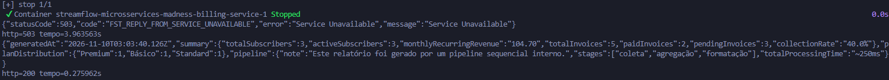

O analytics funciona sem o billing porque lê o banco dele diretamente, sem passar pela API. Se o billing mudar uma coluna, o relatório quebra sem aviso *(hipótese)*.

### Quais serviços continuam separados

| Serviço | Decisão | Motivo |
|---|---|---|
| Auth | **Manter** | guarda a chave que assina os tokens e tem picos próprios de login |
| Catalog | **Manter** | muito consultado, fácil de colocar em cache |
| Streaming | **Manter** | centro do produto |
| Recommendation | **Manter** | área própria, o processamento pode crescer |
| Notification | **Passar a ler de uma fila** | só espera e responde |
| Billing e Analytics | **Juntar** | mesma área e mesmo banco |

**Por que não juntar tudo?** A chave do auth não deve ficar exposta a falhas de outro código, e catalog e streaming recebem cargas diferentes. Juntar tudo num programa só levaria a dependência atual entre os serviços para dentro dele.

**Base no guia:** seção 2.5 (Quando não adotar microsserviços), seção 3.3 (Banco de Dados por Serviço), seção 4.2 (Strangler Fig, para migrar aos poucos) e seção 15 (Erros Comuns e Antipadrões).

**Vídeo (11:15 a 13:18):** o vídeo acerta o alcance do caso. Ele diz que só o pipeline de monitoramento virou monolito e que o resto do Prime Video, como recomendações e entrega de conteúdo, continuou distribuído. A simplificação está no motivo da economia. O vídeo credita os 90% ao fim da "*inter-service network overhead*" (o custo de rede entre serviços). O relato de Kolny aponta outra coisa: a cobrança do Step Functions a cada passagem entre etapas e as leituras e escritas no S3. Quem vê só o vídeo pode concluir que diminuir chamadas HTTP gera 90% de economia, e isso não vale para a StreamFlow. O critério do vídeo continua útil: "*Distributing a chain doesn't make it faster. It just adds links*" (distribuir uma corrente não a deixa mais rápida, só acrescenta elos). O argumento depende de duas coisas: etapas em sequência e comunicação cara entre elas. O analytics da StreamFlow só tem a primeira.

**Vídeo (1:00 a 1:18):** o vídeo reconhece que publicar e escalar cada parte de forma independente são vantagens reais "*when the organizational conditions are right*" (quando a organização está preparada). Essas vantagens continuam valendo para auth, catalog, streaming e recommendation, e por isso eles ficam separados.

---

## Tabela de Decisões Priorizadas

| # | Ação | Evidência | Benefício | Custo e risco | Como validar |
|---|---|---|---|---|---|
| 1 | Corrigir a ordem dos campos no health do gateway | P07, P08 | health que separa sistema sadio de sistema com falha | quase nenhum | 200 com tudo ativo, 503 com um serviço parado |
| 2 | Passar o `x-request-id` entre os serviços e incluir o usuário nos erros | P05, P06 | seguir uma requisição de ponta a ponta | baixo | mesmo ID nos 5 serviços |
| 3 | Conferir se cada resposta deu certo e baixar o limite de espera para 300 ms em recommendation e notification | P04 | registrar falhas escondidas e cortar a espera de 2,4 s | muito baixo | Cenário 2 com Play abaixo de 600 ms |
| 4 | Notificação e histórico por fila, sem perder nem repetir avisos | P03, P04, P08 | Play perto de 50 ms e histórico completo | médio: um sistema novo para operar | Play perto do catálogo nos Cenários 1 e 2 |
| 5 | Juntar billing e analytics | P02, P09 | fim do banco compartilhado | médio: migrar dados e rotas | rotas com as mesmas respostas |
| 6 | Health que testa o banco e Play de teste | P07, P08 | health que reflete o negócio | baixo | health falha quando o Play falha |
| 7 | Métricas, alertas e tracing | Seção 3 | saber onde, quanto tempo e quantos usuários | médio: ferramentas novas | alerta disparado em teste |
| 8 | Filtrar recomendações pelo catálogo, depois eventos | P10 | nenhum filme sem licença na lista | baixo, depois médio | repetir o teste do P10 |
| 9 | Checar assinatura no Play | código do streaming | aplicar a regra de negócio que falta | baixo a médio | assinante cancelado recebe 403 |
| 10 | Manuais, donos definidos e plantão em rodízio | Seção 5 | menos dependência de poucas pessoas | tempo da equipe | incidente simulado resolvido por outro time |

---

## Seção Bônus: Moleculer.js

> _"Alguém mencionou o Moleculer.js. Pesquise e me diga o que ele resolve de graça, o que ele esconde e se vale a pena migrar."_

Fonte: [documentação do Moleculer 0.15](https://moleculer.services/docs/0.15/), acesso em 04/11/2026.

### O que ele resolve

| Problema da StreamFlow | Recurso do Moleculer | Vem ligado? |
|---|---|---|
| endereços dos serviços escritos à mão | descoberta automática dos serviços | sim |
| uma cópia de cada serviço | divisão da carga entre cópias | sim |
| limites de espera escritos à mão | `requestTimeout` | não |
| nenhuma nova tentativa | `retryPolicy` | não |
| serviço com falha continua sendo chamado | `circuitBreaker` (para de chamar quem está falhando) | não |
| falhas só viram warning | `fallback` (resposta alternativa) | não |
| sem tracing | tracing | não |
| sem métricas | métricas | não |
| notificação esperada pelo Play | eventos com `broker.emit` | sim |

A maioria dos recursos úteis para a StreamFlow vem desligada. A equipe ainda precisa ligar e ajustar cada um.

```javascript
// Hoje: o streaming chama cada serviço pelo endereço
await fetch(`${CATALOG_URL}/catalog/${movieId}/license`, { signal: AbortSignal.timeout(5000) });

// Com Moleculer: chama pelo nome e manda um evento para o que pode esperar
const license = await broker.call('catalog.license', { movieId }, { timeout: 500 });
broker.emit('play.started', { sessionId, userId, movieId });
```

### O que ele esconde

1. **Um sistema a mais.** Com vários servidores, a comunicação passa por um intermediário (NATS, Redis ou Kafka), que a equipe precisa operar.
2. **Entrega sem garantia.** O `broker.emit` não confirma se o evento chegou. Para isso é preciso um módulo extra ou a solução da Seção 2.
3. **Repetição.** Uma nova tentativa automática ao gravar o histórico registraria a mesma visualização duas vezes.
4. **Rede disfarçada.** `broker.call` parece uma função comum, mas passa pela rede. O Cenário 2 mostrou o custo disso: um serviço parado deixou o Play cerca de 2,2 s mais lento sem erro visível.
5. **Dependência do framework.** Sair dele depois exige reescrever toda a comunicação.

**Vídeo (1:50 a 3:00 e 15:17 a 15:22):** o vídeo mostra que ferramentas como Kubernetes e Istio resolvem problemas, mas exigem uma equipe para operá-las. O Moleculer segue a mesma lógica. Na conclusão, o vídeo defende que a arquitetura certa é a que a equipe consegue operar.

### Recomendação: não migrar agora

A equipe está desfalcada, e trocar a comunicação dos 8 componentes não resolve a causa dos incidentes, que é a falta de monitoramento. Os mesmos recursos podem entrar aos poucos, com bibliotecas separadas para tracing, métricas e fila. A migração pode ser reavaliada depois das ações 1 a 7 da tabela, começando por um teste num serviço novo, como o leitor da fila de notificações.
